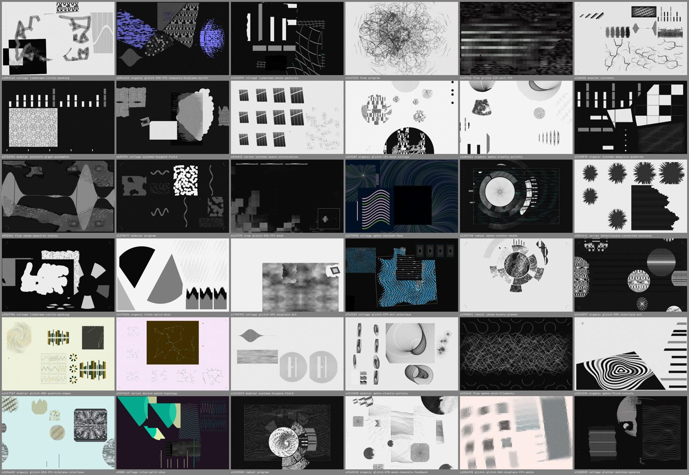
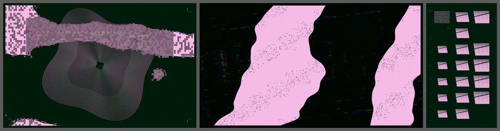

# default_wallpapers

**Wallpaper Generator** — a small macOS menu-bar app that creates generative
wallpapers and sets them as the system desktop picture on every screen (they also
appear on the lock screen). It is the wallpaper part of `default_desktop`, without
widgets or anything else.

[Русская версия ниже](#по-русски)



## Download

Get `Wallpaper Generator.zip` from [Releases](../../releases), unzip it and move
the app wherever you like. The app is ad-hoc signed, not notarized, so the first
launch needs one of these:

- right-click `Wallpaper Generator.app` → **Open** → **Open**, or
- `xattr -dr com.apple.quarantine "/path/to/Wallpaper Generator.app"`

Requires macOS 14 or newer; universal build (Apple silicon and Intel).

## Use

The app lives in the menu bar (◫):

- **Сгенерировать для всех экранов / Generate for all screens** — a new set of works.
- **Сохранить / Save** — saves the main screen's work as an animated, self-contained
  p5.js sketch (`index.html`, `sketch.js`, `p5.min.js`) plus the still PNG into
  `~/Documents/Wallpaper Generator`.
- **Менять каждый час / Change every hour** — on / off.
- **Открыть папку / Open folder**, **Выйти / Quit**.

With several displays every screen gets its own work, rendered at that screen's
native resolution and proportions, sharing one palette so the set belongs together.
Connecting a display renders a work only for the new screen.



The engine runs in a temporary WebKit view only while it renders; afterwards the app
is idle. It works offline, uses no accounts and no photos. Data:
`~/Library/Application Support/audio.default.wallpaper-generator`.

## How the pictures are made

Original procedural code (p5.js / Canvas 2D, no AI, no downloaded artwork):
244 families — line systems, 3D plotter drawings with hidden-line removal,
interface-like instrument graphics, simulations, and 112 experimental raster rules
(datamoshing, pixel sorting, displacement, collage, an "image as audio" round trip
with EQ / comb filter / bitcrush, FFT and DCT faults, feedback). Nine composition
engines (modular grids, free layers and sectors, organic circles / Voronoi, collage,
flow masks, radial, series, extreme crop, glitch pass) place them; a small critic
picks among several candidates. Every work is reproducible from its saved recipe.

## Build from source

```sh
./build.sh            # → build/Wallpaper Generator.app and build/Wallpaper Generator.zip
```

Needs Xcode command line tools (swiftc, lipo, codesign). `Sources/Generator.swift`
is the app; `art/` is the engine (load order in `art/engine.json`).

## Licences

`art/p5.min.js` is [p5.js](https://p5js.org) 2.3.4, LGPL-2.1, licence text in
`art/p5-LICENSE.txt`. No licence has been chosen yet for the rest of this
repository.

---

## По-русски

**Wallpaper Generator** — маленькое приложение в строке меню macOS: генерирует обои и
ставит их системной картинкой рабочего стола на все экраны (видно и на экране
блокировки). Это часть `default_desktop` только с обоями — без виджетов и прочего.

**Установка.** Скачайте `Wallpaper Generator.zip` в [Releases](../../releases),
распакуйте. Приложение не нотаризовано, поэтому первый запуск: правый клик →
**Открыть** → **Открыть**, или
`xattr -dr com.apple.quarantine "/путь/к/Wallpaper Generator.app"`.
Нужна macOS 14+, работает на Apple silicon и Intel.

**Меню (◫):** «Сгенерировать для всех экранов», «Сохранить» (анимированный p5.js-скетч
и PNG в `~/Documents/Wallpaper Generator`), «Менять каждый час», «Открыть папку»,
«Выйти». Если экранов несколько, у каждого своя работа в его разрешении и пропорциях,
с общей палитрой. Работает без сети, без аккаунтов и без фото; движок запускается
только на время рендера.

**Сборка:** `./build.sh` → `build/Wallpaper Generator.app` и `.zip`.

**Лицензии:** `art/p5.min.js` — p5.js 2.3.4 (LGPL-2.1, текст в `art/p5-LICENSE.txt`).
Для остального кода лицензия пока не выбрана.
